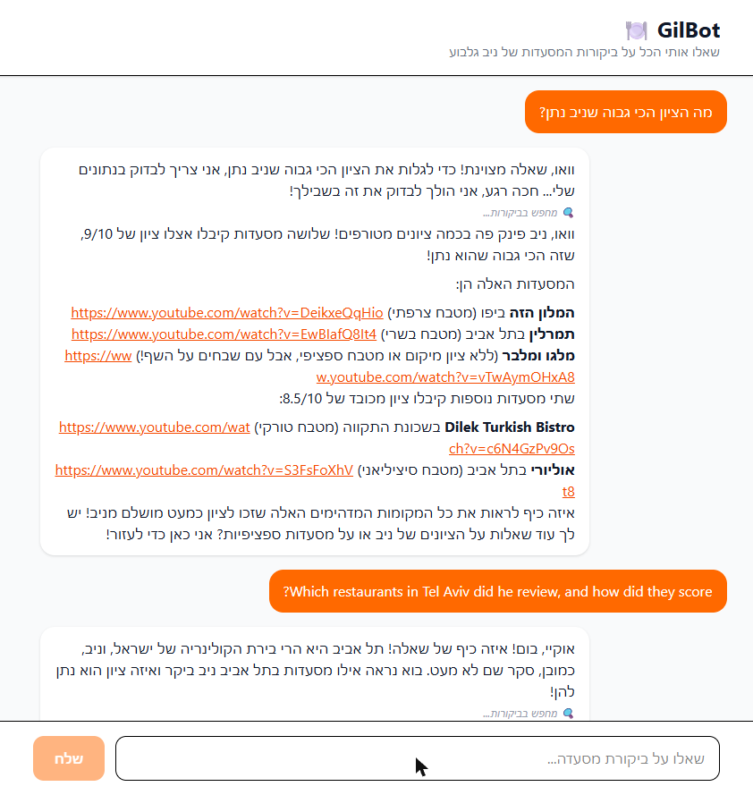

# GilBot

A chatbot that has watched every restaurant review so you don't have to. Ask it, in Hebrew or English, what Israeli food critic Niv Gilboa said about a restaurant, which place scored highest, or where to eat in Tel Aviv, and it answers from his actual YouTube reviews with the grade and a link to the video.

<p align="center">
  
</p>

**Stack:** Next.js 16 · React 19 · TypeScript · Vercel AI SDK · Gemini 2.5 Flash · Gemini embeddings · Upstash Vector · Tailwind CSS 4 · Zod

## How it works

GilBot is retrieval-augmented generation with tool calling. The model never answers from memory: it picks one of two tools, reads the result, and only then replies.

```
                 ┌──────────────────────── ingest (offline, 4 scripts) ────────────────────────┐
YouTube channel ─▶ video IDs ─▶ Hebrew transcripts ─▶ structured metadata ─▶ chunks + embeddings
                   (yt-dlp)      (subtitles → text)    (Gemini + Zod schema)   (Upstash Vector)
                                                              │                       │
                                                       restaurants.json               │
                                                              │                       │
                 ┌────────────────────────── chat (per request) ──────────────────────┼────────┐
   question ─▶ Gemini 2.5 Flash ──┬─▶ getRestaurantStats ─────┘                       │
                                  │     grades, averages, by city, by name            │
                                  └─▶ getReviewContent ───────────────────────────────┘
                                        semantic search over transcript chunks
                                  ◀── streamed answer: grade, quote, video link
```

### Two tools, because there are two kinds of question

| Question | Tool | Why |
|---|---|---|
| "What did he think of the pasta at X?" | `getReviewContent` | Needs the words he actually said: semantic search over transcript chunks |
| "What's the highest grade he ever gave?" | `getRestaurantStats` | Needs every review at once: vector search can't aggregate, a JSON table can |

Splitting them was the key design decision. Pure RAG answers "highest grade" badly, because the top-5 similar chunks are not the top-5 grades. So the ingest step also extracts a small structured table, and the model routes each question to the right source.

### Ingest pipeline

| Step | Script | What it does |
|---|---|---|
| 1 | `scripts/01-fetch-video-ids.ts` | Lists the channel's latest videos with `yt-dlp` |
| 2 | `scripts/02-fetch-transcripts.ts` | Downloads Hebrew subtitles, strips timestamps, de-duplicates auto-caption repeats |
| 3 | `scripts/03-extract-metadata.ts` | Gemini reads each transcript's intro and ending (where the verdict is) and returns a Zod-validated object: restaurant, grade, cuisine, city |
| 4 | `scripts/04-generate-embeddings.ts` | Splits transcripts into overlapping ~600-character chunks, embeds them (768 dimensions) and upserts to Upstash Vector with the restaurant and grade as metadata |

Every step is resumable: each one records what it has finished and skips it on the next run, so a rate limit halfway through costs nothing.

## Details worth noticing

- **It can't make things up quietly.** The system prompt forbids answering about a restaurant without a tool call, and tells the model to say so when the knowledge base has nothing.
- **Bilingual, right-to-left.** The UI is RTL Hebrew; the bot replies in whichever language you wrote in and always uses the restaurant's Hebrew name.
- **Bounded cost.** A request can take at most 3 model steps (`stopWhen: stepCountIs(3)`), and metadata extraction sends only the first 500 and last 2,000 characters of each transcript instead of the whole thing.
- **Streaming.** Answers stream token by token, with a visible "searching the reviews…" state while a tool runs.

## The dataset

30 reviews indexed, every one with a grade. Average grade 7.15 out of 10, ranging from 3 to 9. The extracted table is in [`data/restaurants.json`](data/restaurants.json). Transcripts are not committed; they are regenerated by the ingest scripts.

## Run it

Requirements: Node 20+, a [Google AI Studio](https://aistudio.google.com/) API key, a free [Upstash Vector](https://upstash.com/docs/vector) index (768 dimensions, cosine), and [`yt-dlp`](https://github.com/yt-dlp/yt-dlp) on your PATH for ingesting.

Create a file named `.env.local` in the project root with these three values:

```
GOOGLE_GENERATIVE_AI_API_KEY=
UPSTASH_VECTOR_REST_URL=
UPSTASH_VECTOR_REST_TOKEN=
```

Then:

```bash
npm install

npm run ingest                 # fetch videos → transcripts → metadata → embeddings
npm run dev                    # http://localhost:3000
```

The ingest steps can also be run one at a time: `ingest:videos`, `ingest:transcripts`, `ingest:metadata`, `ingest:embeddings`.

## Project layout

```
src/app/page.tsx              chat UI (useChat, streaming, RTL)
src/app/api/chat/route.ts     the two tools and the streaming endpoint
src/lib/ai/                   model choices and vector search
src/lib/data/restaurants.ts   queries over the structured table
src/lib/prompts/system.ts     the system prompt
scripts/                      the four ingest steps, plus two one-off data fixes
data/                         video list and extracted restaurant table
```

## Notes

This is an unofficial fan project and is not affiliated with Niv Gilboa. All review content belongs to him; the bot links back to the original video for every restaurant it mentions.
